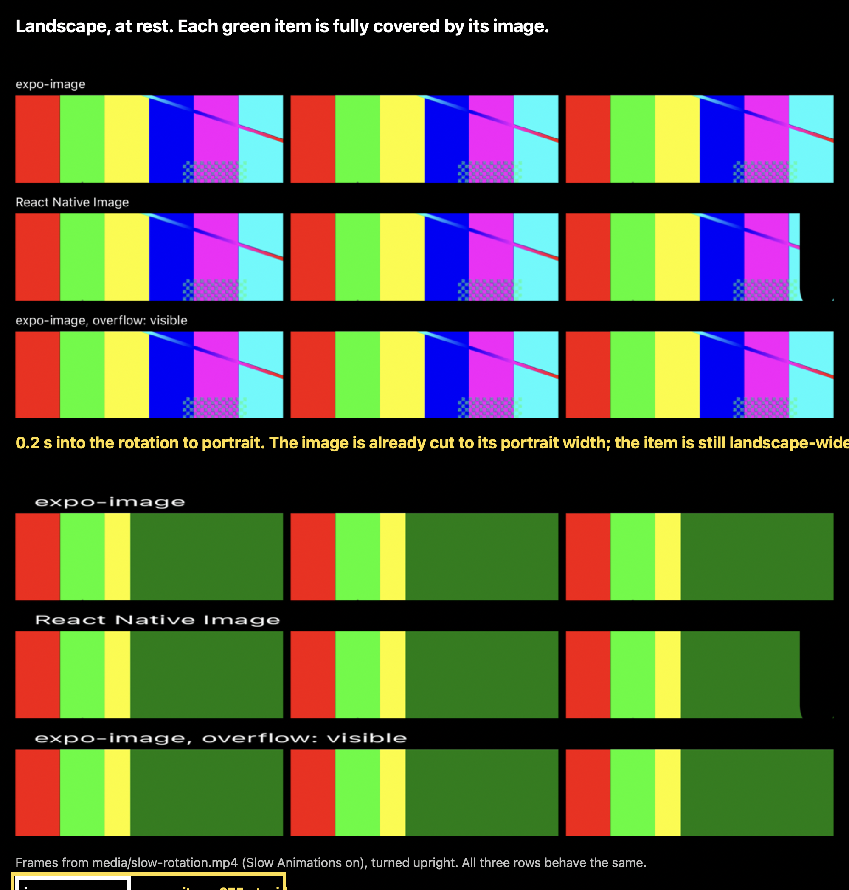
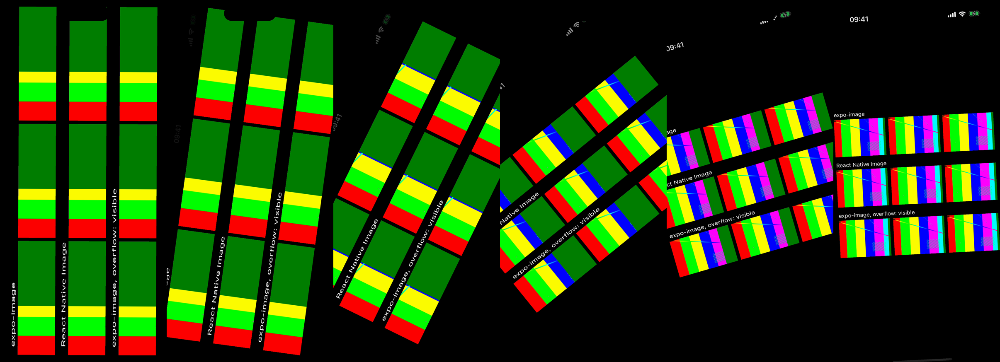
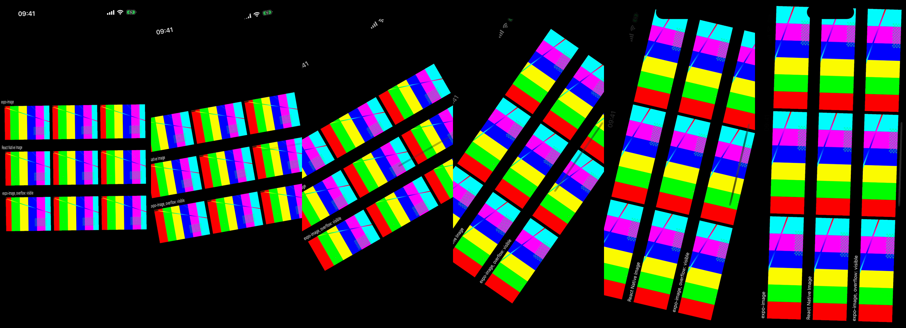
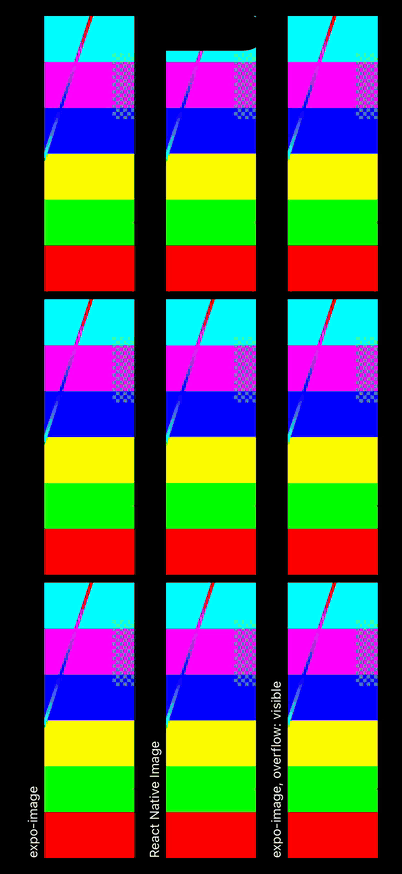

# expo-image is clipped to its final size during rotation (iOS)

Reproduction for https://github.com/expo/expo/issues/54040 on iOS, with slow-motion screen
recordings of the rotation and a React Native `Image` next to it for comparison.

Versions: Expo SDK 58 (`expo` 58.0.26), `expo-image` 58.0.18, `expo-modules-core` 58.1.0,
`react-native` 0.88.1, New Architecture.
Recorded on the iPhone 17 Pro simulator, iOS 26.5, Xcode 27.2, 11/23/26.

## Run

```sh
npm install
npx expo run:ios   # development build, iOS simulator or device
```

Rotate between portrait and landscape. In the simulator, turn on **Device > Slow Animations**
(DeviceHub in Xcode 27, Debug > Slow Animations in older Simulator.app) and rotate with
Cmd+Left / Cmd+Right. The clipping is easiest to see going from landscape to portrait.

## What the screen shows

Three rows of three green items. Each item is `flex: 1` in a row, so its width changes with the
orientation, and each holds one image at 100% width and height with `cover` fit, from a bundled
1,200 × 800 test pattern.

| Row | Component |
| --- | --- |
| expo-image | `expo-image` `Image`, `contentFit="cover"` |
| React Native Image | `react-native` `Image`, `resizeMode="cover"` |
| expo-image, overflow: visible | `expo-image` `Image` with `overflow: 'visible'` in its style from the first render |

Nothing else animates. Whatever moves during a rotation is UIKit's own rotation animation.

## Result

| Phase | Green item | expo-image | React Native Image | expo-image, overflow: visible |
| --- | --- | --- | --- | --- |
| Portrait, at rest | 118 pt wide | fills the item | fills the item | fills the item |
| Rotating portrait → landscape | grows 118 → 275 pt | fills the item while it grows | same | same |
| Landscape, at rest | 275 pt wide | fills the item | fills the item | fills the item |
| **Rotating landscape → portrait** | shrinks 275 → 118 pt | **image already cut to 118 pt, green shows next to it for the whole animation** | **same** | **same** |
| Portrait, at rest | 118 pt wide | fills the item | fills the item | fills the item |

With Slow Animations on, the rotation takes about 3 s and the gap is visible in every frame of it
(`media/landscape-to-portrait-frames.png`, one frame every 0.5 s). At normal speed the same thing
happens for the ~0.4 s of the rotation (`media/normal-rotation.mp4`).

`overflow: 'visible'` on the expo-image does not change anything, so there is no way around it
from JavaScript. The React Native `Image` row behaves the same, which matches the React Native
issue linked from the Expo issue.

Step logs with timestamps: `media/slow-rotation.txt`, `media/normal-rotation.txt`.

## Media

The clearest single picture. Top: landscape, at rest. Bottom: the same screen 0.2 s into the
rotation towards portrait, from the slow-motion recording, turned upright. The green items are
still at their landscape width (yellow outline, 275 pt), but every image in every row is already
cut to its portrait width (white outline, 118 pt), and the rest of each item shows the item's
green background:



Landscape → portrait with Slow Animations on, one frame every 0.5 s. The image in every row is
already at its final narrow width while the green item behind it is still wide:



Portrait → landscape, same recording. Nothing is cut off in this direction because the mask is
already at the larger final size:





Screen recordings: `media/slow-rotation.mp4` (Slow Animations on, both directions, ~20 s) and
`media/normal-rotation.mp4` (normal speed).
Full slow-motion GIF: `media/slow-rotation.gif`.
Screenshots: `media/slow-rotation-0-portrait.png` through `media/slow-rotation-6-portrait.png`;
`slow-rotation-4-rotating-to-portrait.png` is taken 1.7 s into the landscape → portrait rotation.
Simulator and toolchain details: `media/simulator-ios-version.txt`.

## Cause

React Native's `RCTViewComponentView.mm` (`invalidateLayer`) puts a mask layer on every
`UIImageView` subview of a view that clips its content, sized to that subview's bounds at the time
of the layout. The mask is a plain `CAShapeLayer`; UIKit animates the view's bounds during a
rotation, but nothing animates the mask, so the mask is at the end-of-rotation size while the
view is still mid-animation.

expo-image's `ImageView.swift` sets `clipsToBounds = true` in its initializer and adds
`sdImageView`, an `SDAnimatedImageView` (a `UIImageView`), as a direct subview, so the same mask
lands on it. `applyContentPosition` already compensates that mask when it moves the image for
`contentPosition`, but only its origin, not an animated size. Because expo-image turns clipping on
itself, `overflow: 'visible'` from JavaScript does not prevent the mask.

## Workaround

None from JavaScript. `overflow: 'visible'` on the image makes no difference (third row), and a
`borderRadius` is not involved. For a size change you drive yourself, animate it with `Animated`
or Reanimated instead of relying on a UIKit animation: every frame then re-lays out the view and
React Native recreates the mask at the current size.

A fix in expo-image would host `sdImageView` inside a plain `UIView` that does the clipping, so
React Native's loop no longer finds a `UIImageView` to mask and the image animates with its
container. That would also make the mask compensation in `applyContentPosition` unnecessary.
